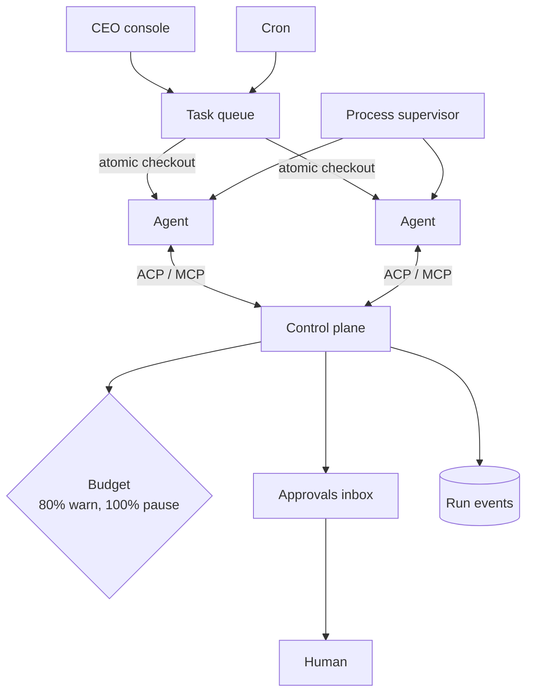

# Agent Dash

**Status:** personal use · **Stack:** Node, TypeScript, React, ACP, MCP

[← Back to portfolio](../README.md)

## Problem
Running several AI coding agents at once gets chaotic: two agents pick up the same task, a runaway agent burns through budget, and risky actions happen without anyone signing off.

## What I built
A control plane that runs agents like a small organisation:
- **Org chart** of agents and their roles.
- **Atomic task checkout**, so two agents can't take the same task.
- **Budgets** with a warning at 80% and an automatic pause at 100%.
- **Approvals inbox** for actions that need a human.
- **Cron** for scheduled work and **Windows process supervision** for the agents themselves.
- **CEO console** that takes a goal and delegates it down the org chart.
- Agents connect over **ACP and MCP**.

## Architecture

## Results
| Measure | Result |
|---|---|
| Commits | 370 in 8 days |
| Review findings | 17 (NO-GO), all fixed |
| Time to ready | 1.6 s |
| Time to first text | 119 s |

## Hard problems
- **Review said NO-GO.** The independent review found 17 issues. Each was fixed with a test written to fail first, then made to pass.
- **Measuring latency honestly.** Timings come from traced run events, not stopwatch demos. The agent is ready in 1.6 s, but the first text arrives at 119 s, which shows where the real wait is.
- **Concurrency.** Task checkout has to be atomic, or two agents do the same work and overwrite each other.
