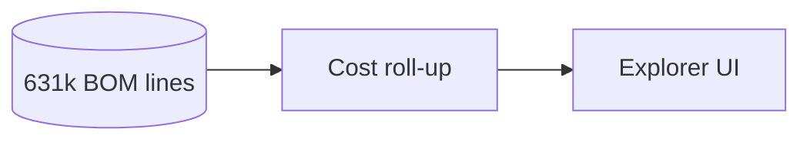

# BOM cost explorer

**Status:** live · **Type:** data product

[← Back to portfolio](../README.md)

## Problem
Bills of materials for a heavy-truck OEM's vehicles run to hundreds of thousands of lines. Rolling up cost across them is easy to get wrong in a way that looks plausible.

## What I built
- A cost explorer over **631k BOM lines**.

## Architecture

## Results
| Measure | Result |
|---|---|
| BOM lines | 631k |
| Overcount prevented | 72× spend |

## Hard problems
- **A 72× overcount.** A naive roll-up would have counted spend 72 times over. Catching it before release is the most valuable thing the tool did.
