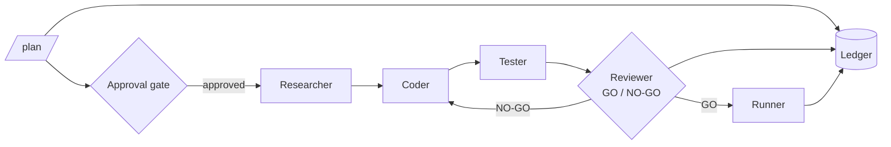

# Bunki workflow

**Status:** my AI-first build process · **Stack:** Claude Code, multi-agent roles, plan ledger

[← Back to portfolio](../README.md)

## Problem
A single AI coding session that plans, writes, tests and approves its own work grades itself. That is fast, but it misses things.

## What I built
- **Separate roles** in Claude Code: researcher, coder, tester, reviewer and runner. The reviewer hasn't written the code it reviews.
- **`/plan` with an approval gate:** nothing is built until the plan is approved.
- **A ledger** that records every plan, what changed during execution, and every review finding.

## Architecture

## Results
| Measure | Result |
|---|---|
| Plans | 38 across 22 projects |
| Went through clean | 4 |
| Corrected during execution | 34 |
| Abandoned | 0 |
| Recorded review findings | 25 |
| NO-GOs fixed before release | at least 7 |

## Hard problems
- **Most plans change.** 34 of 38 plans were corrected along the way. The ledger makes that visible instead of pretending the first plan was right.
- **Independence.** The value of review comes from the reviewer not sharing the coder's assumptions, which is why the roles are separate.
