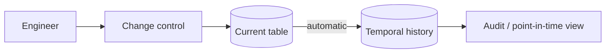

# Calibration change control

**Type:** automation · **Stack:** SQL Server with temporal history

[← Back to portfolio](../README.md)

## Problem
Calibration changes at a heavy-truck OEM need a full, trustworthy history: who changed what, when, and what it was before.

## What I built
- Change control for calibrations on **SQL Server temporal tables**, so every previous version is kept automatically by the database.

## Architecture

## Results
| Measure | Result |
|---|---|
| Tests | 311 |

## Hard problems
- **History you can't forget to write.** Temporal tables record history in the database itself, so no application code path can skip it.
