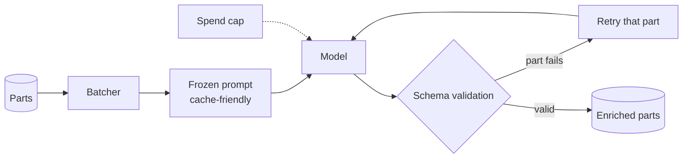

# LLM catalogue enrichment benchmark

**Status:** benchmark · **Domain:** e-commerce parts catalogue

[← Back to portfolio](../README.md)

## Problem
A heavy-truck OEM's parts catalogue needs structured attributes filled in. LLMs can do it, but cost, reliability and made-up values all need measuring before trusting them.

## What I built
- A benchmark comparing models and settings on catalogue enrichment.
- **Batching** several parts per request.
- **Schema validation** of every output, with **per-part retry**, so one bad part doesn't fail the batch.
- A **spend cap** on every run.
- A **frozen prompt** so prompt caching applies.

## Architecture

## Results
| Measure | Result |
|---|---|
| Cost reduction from batching | 1.5–2.3× |

## Hard problems
- **Invented values.** One model returned a value outside the allowed list. Schema validation against the allowed values caught it; without it, the bad value would have gone straight into the catalogue.
- **Retry granularity.** Retrying a whole batch wastes money; retrying only the failed part keeps batching's savings.
