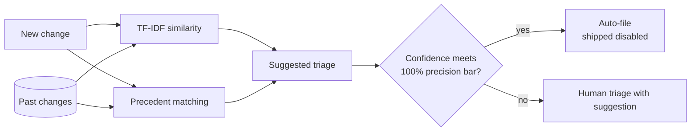

# Change-triage ML engine

**Status:** shipped with auto-file disabled · **Stack:** Python, TF-IDF, precedent matching

[← Back to portfolio](../README.md)

## Problem
Incoming changes at a heavy-truck OEM have to be triaged and filed. Many resemble past changes, so precedent should be able to do much of the work.

## What I built
- **Precedent matching** against past changes, combined with **TF-IDF** text similarity.
- A **walk-forward backtest**: train on the past, predict the next period, roll forward. No peeking at the future.
- An **auto-file** mode gated on precision.

## Architecture

## Results
| Measure | Result |
|---|---|
| Walk-forward agreement | 91.5% |
| Auto-file coverage at 100% precision | 29% (target 60%) |

## Hard problems
- **Good isn't good enough for automation.** 91.5% agreement is useful as a suggestion, but filing automatically needs to be right every time. At 100% precision it covered only 29% of cases, below the 60% target, so auto-file shipped disabled and suggestions go to people.
