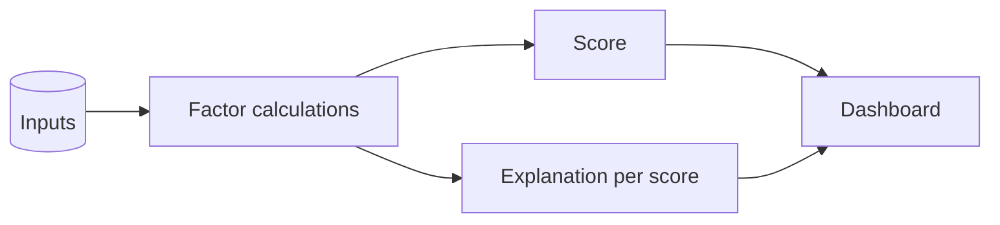

# Customer-fit scoring dashboard

**Type:** data product · **Pattern:** explainable scoring

[← Back to portfolio](../README.md)

## Problem
A heavy-truck OEM needs to score how well customers fit, and a bare score that nobody can explain doesn't get trusted or used.

## What I built
- An **explainable score**: each score shows the factors that produced it.
- A dashboard for exploring and sorting by fit.

## Architecture

## Results
| Measure | Result |
|---|---|
| Tests | 246 |

## Hard problems
- **Explainability over cleverness.** A score people can trace back to factors is more useful than a slightly better one they can't.
