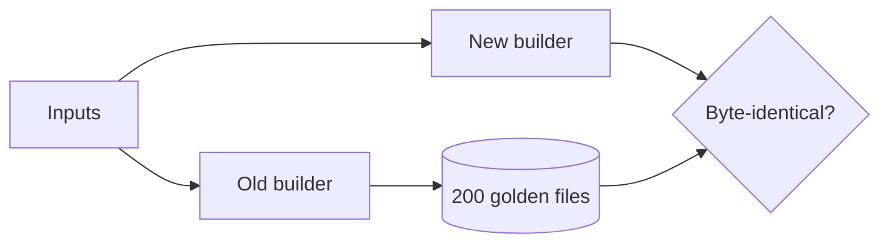

# Definition-file builder rewrite

**Type:** vehicle engineering · **Pattern:** performance rewrite with golden-file equivalence

[← Back to portfolio](../README.md)

## Problem
A tool that builds vehicle definition files at a heavy-truck OEM was slow and memory-hungry. A rewrite had to be faster without changing a single byte of output.

## What I built
- A rewrite of the builder.
- A **golden-file harness**: 200 known-good outputs that the new builder must reproduce byte for byte.

## Architecture

## Results
| Measure | Before → after |
|---|---|
| Build time | 2.5 min → **2.15 s** |
| Memory | 555 MB → **102 MB** |
| Golden files byte-identical | **200/200** |
| Tests | 433 |

## Hard problems
- **Proving nothing changed.** Speed is easy to show; equivalence isn't. Byte-identical output on 200 golden files is the proof.
