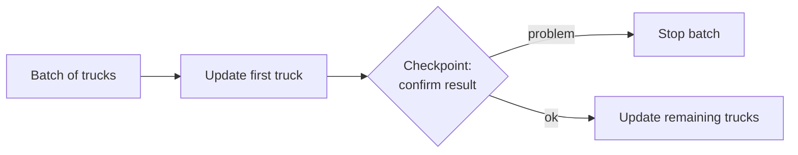

# ECU bulk update

**Type:** vehicle engineering · **Pattern:** checkpointed batch with independent review

[← Back to portfolio](../README.md)

## Problem
Updating ECUs across many trucks at a heavy-truck OEM in one batch is efficient, but a mistake repeated across a whole batch is expensive.

## What I built
- A bulk update tool with a **checkpoint after the first truck**: the batch pauses for confirmation once the first one is done.

## Architecture

## Results
| Measure | Result |
|---|---|
| High-severity review findings | 5, all fixed before release |

## Hard problems
- **Review earned its keep.** The independent review found 5 high-severity bugs. All were fixed before the tool touched a vehicle.
