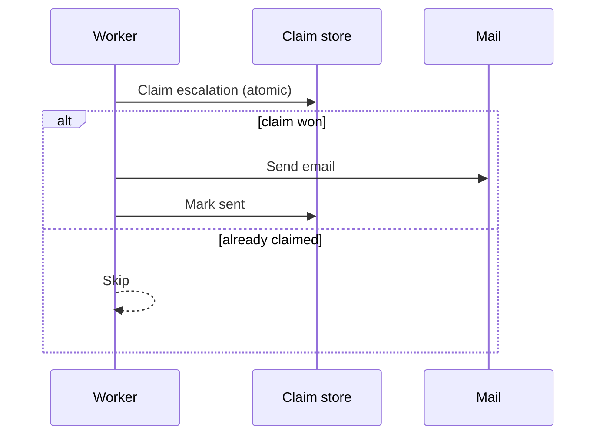

# Exactly-once escalation emailer

**Type:** automation · **Pattern:** claim-first design

[← Back to portfolio](../README.md)

## Problem
Escalation emails at a heavy-truck OEM must go out exactly once. Sending none misses the escalation; sending two, or one per retry, trains people to ignore them.

## What I built
- An emailer with a **claim-first design**: each escalation is claimed before the email is sent, so a retry or a second worker sees the claim and doesn't send again.

## Architecture

## Hard problems
- **Exactly once is a design choice.** Sending first and recording after risks duplicates on retry; claiming first makes the claim the single source of truth.
