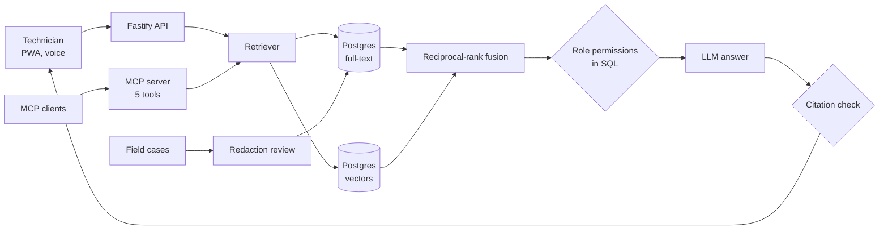

# Field-technician assistant (RAG)

**Status:** prototype · **Stack:** React PWA (offline-first), Fastify, Postgres (full-text + vectors), MCP

[← Back to portfolio](../README.md)

## Problem
Field technicians at a heavy-truck OEM need answers from hundreds of service manuals, including where there's no connection. Keyword search misses relevant passages, and an answer without a traceable source isn't safe to act on.

## What I built
- **Offline-first React PWA** with voice input, backed by a Fastify API.
- **Hybrid retrieval in Postgres:** full-text search and vector search fused with reciprocal-rank fusion, over 270 manuals split into 10,573 chunks.
- **Citations enforced:** every answer must cite the chunks it came from, and citation codes are checked against the retrieved set.
- **Role permissions enforced inside SQL**, so the retriever can never return a document the user isn't allowed to see. Verified with a 38/38 access matrix.
- **MCP server with 5 tools**, so other agents and clients can use the same retrieval and permission rules.
- **Field-case learning loop:** solved cases from the field feed back in, through a redaction review before anything is stored.

## Architecture

## Results
| Measure | Result |
|---|---|
| hit@5, hybrid retrieval | **81%** (70% under a live 2 s timeout) |
| hit@5, keyword baseline | 59.5% |
| Wrong citation codes | 354 → **0** |
| Access matrix | 38/38 |
| Tests | 1,494 |

## Hard problems
- **Speed versus recall.** Hybrid retrieval reaches 81% hit@5, but under the live 2-second budget it drops to 70%. Both numbers are reported, because the second is what a technician gets.
- **Citations that point at the wrong place.** The model produced 354 wrong citation codes before enforcement; checking every citation against the retrieved chunks brought it to zero.
- **Permissions that can't be bypassed.** Filtering after retrieval leaks; pushing role rules into the SQL itself means a document the user can't see never reaches the model.
- **Independent review.** The release review said NO-GO twice before GO.
- **Still open:** refusal tuning, so the assistant declines when the manuals don't cover a question without refusing ones they do.
