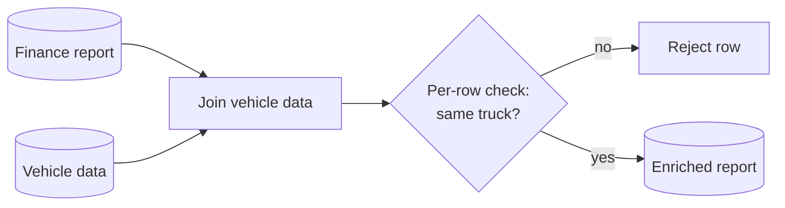

# Finance-report enrichment

**Status:** live · **Type:** data product

[← Back to portfolio](../README.md)

## Problem
Finance reports at a heavy-truck OEM need extra data joined in per vehicle. A bad join puts one truck's data on another truck's row, and nobody notices until it matters.

## What I built
- Enrichment of finance reports with vehicle data.
- A **per-row check** that each enriched row matches the right truck before it is written.

## Architecture

## Results
| Measure | Result |
|---|---|
| Tests | 230 |

## Hard problems
- **Silent misalignment.** The check exists because wrong-truck data looks perfectly normal on a report.
