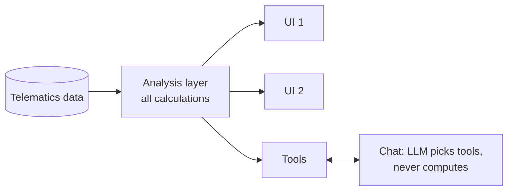

# Fleet telematics analytics

**Type:** data product · **Pattern:** one analysis layer, three UIs, tool-calling chat

[← Back to portfolio](../README.md)

## Problem
Fleet telematics from a heavy-truck OEM's vehicles answers questions for several audiences, each wanting its own interface. Three UIs with three sets of calculations would drift apart, and a chat interface that lets the LLM do arithmetic would get numbers wrong.

## What I built
- **One analysis layer** that owns every calculation.
- **Three UIs** on top of it, including a **tool-calling chat**.
- In the chat, **the LLM never computes numbers.** It calls analysis tools and reports what they return.

## Architecture

## Results
| Measure | Result |
|---|---|
| Tests | 857 |

## Hard problems
- **A mean-of-ratios trap.** Averaging per-vehicle ratios gives a different, wrong answer from the ratio of totals. Caught and fixed in the analysis layer, so every UI got the fix at once.
- **An "Other" bar at 451%.** A share chart showed "Other" at 451%, which can't be right for a share. Caught before release.
