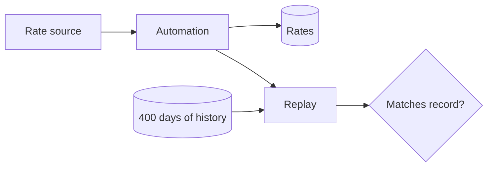

# FX rate automation

**Type:** automation · **Pattern:** replay-tested automation

[← Back to portfolio](../README.md)

## Problem
Foreign-exchange rates at a heavy-truck OEM feed downstream figures, so automating their update is only safe if it reproduces past results.

## What I built
- Automated FX rate retrieval and update.
- A **400-day replay** that runs the automation over historical days and compares the results with the rates on record.

## Architecture

## Results
| Measure | Result |
|---|---|
| 400-day replay | 255/256 matched |
