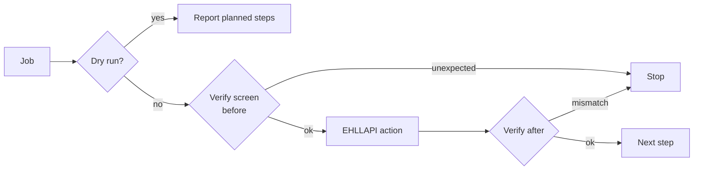

# Guarded 3270 mainframe automation

**Type:** vehicle engineering · **Stack:** EHLLAPI

[← Back to portfolio](../README.md)

## Problem
Some vehicle-engineering work at a heavy-truck OEM still runs through 3270 mainframe screens. Automating them is worthwhile, but a script that types into the wrong field changes production records.

## What I built
- Automation of 3270 screens through **EHLLAPI**.
- **Dry-run by default:** it shows what it would do until told otherwise.
- **Verify before and after every step:** it checks the screen is what it expects before typing, and that the change landed after.

## Architecture

## Hard problems
- **Screens have no API contract.** Every step is checked against what the screen actually shows, because a layout change or an unexpected prompt would otherwise send keystrokes to the wrong place.
