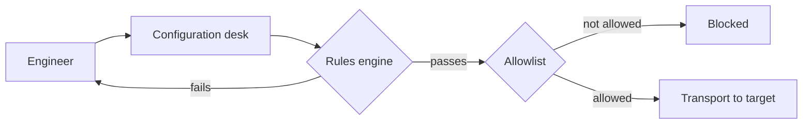

# Parameter configuration desk

**Type:** vehicle engineering · **Pattern:** allowlist transport, rules engine

[← Back to portfolio](../README.md)

## Problem
Vehicle parameters at a heavy-truck OEM have to be configured correctly for each build, and only approved changes may reach the vehicle systems.

## What I built
- A **rules engine** that checks parameter combinations.
- An **allowlist transport**: only explicitly allowed operations can be sent on.

## Architecture

## Results
| Measure | Result |
|---|---|
| Tests | ~1,700 |

## Hard problems
- **Default deny.** An allowlist means a new, unreviewed operation is blocked until someone adds it, rather than allowed until someone notices.
