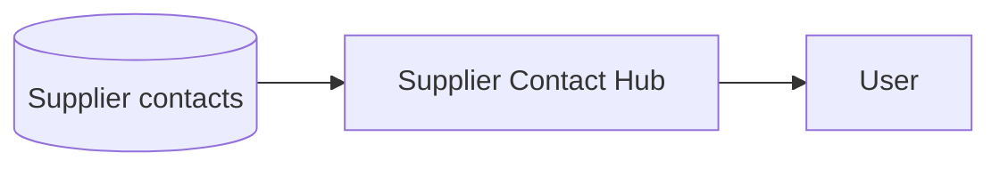

# Supplier Contact Hub

**Type:** automation

[← Back to portfolio](../README.md)

## Problem
Teams at a heavy-truck OEM need a dependable place to find the right supplier contact.

## What I built
- A single hub for supplier contacts.

## Architecture

## Results
| Measure | Result |
|---|---|
| Tests | ~430 |
