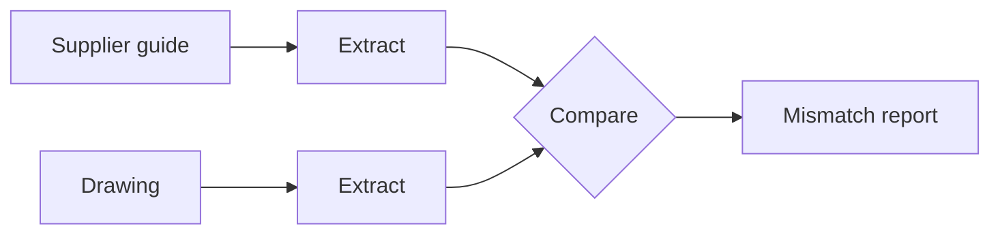

# Supplier guide ↔ drawing verification

**Type:** vehicle engineering · **Pattern:** cross-document consistency checks

[← Back to portfolio](../README.md)

## Problem
Supplier guides and engineering drawings at a heavy-truck OEM describe the same parts, and they need to agree.

## What I built
- Automated checks that compare supplier guides with drawings and flag differences.

## Architecture

## Results
| Measure | Result |
|---|---|
| Tests | 214 |
