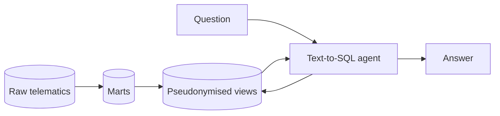

# Telematics marts + private text-to-SQL

**Type:** data product · **Pattern:** curated marts, pseudonymised views, private text-to-SQL agent

[← Back to portfolio](../README.md)

## Problem
Analysts want to ask telematics questions in plain English, but the underlying data contains identifying fields that must never reach a model or an answer.

## What I built
- **Telematics data marts** shaped for analysis.
- **Pseudonymised views** that the text-to-SQL agent queries, instead of the raw tables.
- A **private text-to-SQL agent** over those views, with an eval set.

## Architecture

## Results
| Measure | Result |
|---|---|
| Answerable eval questions passing | 90% |
| Response time | 26 s → 2 s |
| Tests | ~1,000 |

## Hard problems
- **Leaks that scans missed.** Scanning response payloads for identifying data looked clean, but review found leaks anyway. The fix was structural: the agent only sees pseudonymised views.
