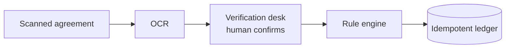

# Warranty-agreement rule engine

**Type:** automation · **Pattern:** rule engine, idempotent ledger, OCR verification desk

[← Back to portfolio](../README.md)

## Problem
Warranty agreements at a heavy-truck OEM have to be applied consistently, often from scanned documents, and each one must be recorded exactly once.

## What I built
- A **rule engine** that applies agreement terms.
- An **idempotent ledger**, so re-running a job never double-records.
- An **OCR verification desk** where people confirm what OCR read before it counts.

## Architecture

## Hard problems
- **OCR is not ground truth.** A person verifies what OCR extracted before the rules act on it.
- **Re-runs are safe.** The ledger is idempotent, so retrying after a failure can't create duplicates.
