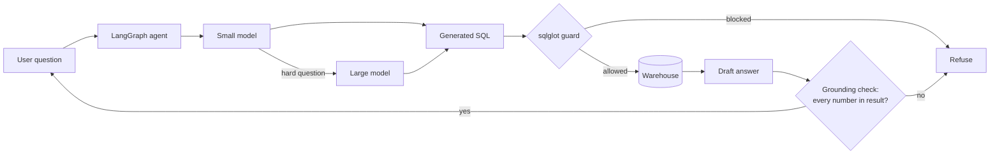

# Warranty Insights "Ask"

**Status:** pilot · **Stack:** Python, LangGraph, sqlglot, Docker, Azure Container Apps (Bicep, OIDC)

[← Back to portfolio](../README.md)

## Problem
People working with a heavy-truck OEM's warranty data want answers from answers without writing SQL. A text-to-SQL agent that invents a number, or runs an unsafe query, is worse than no agent.

## What I built
- **LangGraph text-to-SQL agent** with **small → large model routing**: the small model handles what it can, and harder questions escalate.
- **sqlglot SQL guard:** every generated query is parsed and checked before it runs.
- **Grounding check:** any number in the answer that doesn't appear in the query result is rejected.
- **Golden set** of 76 questions, split 51 dev / 25 holdout, plus 60 adversarial cases.
- **Azure-ready deployment:** Container Apps, fail-closed Easy Auth, Bicep, an OIDC pipeline and non-root Docker. Not yet provisioned.

## Architecture

## Results
| Measure | Baseline → iteration 1 → current |
|---|---|
| Dev accuracy (51 questions) | 21.6% → 41.2% → **60.8%** |
| Holdout accuracy (25 questions) | 4% → 36% → **44%** |
| Ungrounded numbers | **0** |
| Crashes | **0** |
| Adversarial cases blocked | **60** |
| Median latency | 8.6 s → 12.4 s |
| Tests | 721 + 73 |

## Hard problems
- **The target wasn't met.** The goal was 90%; the holdout is at 44%. I reported that rather than tuning on the holdout.
- **Accuracy cost latency.** Routing harder questions to the larger model raised median latency from 8.6 s to 12.4 s. That trade-off is visible in the numbers, not hidden.
- **Never a wrong number.** The grounding check means the agent says "I couldn't answer that" before it says a number that isn't in the data: zero ungrounded numbers across the golden set.
- **Fail closed.** Authentication is configured to deny by default, so a misconfiguration locks people out rather than letting them in.
